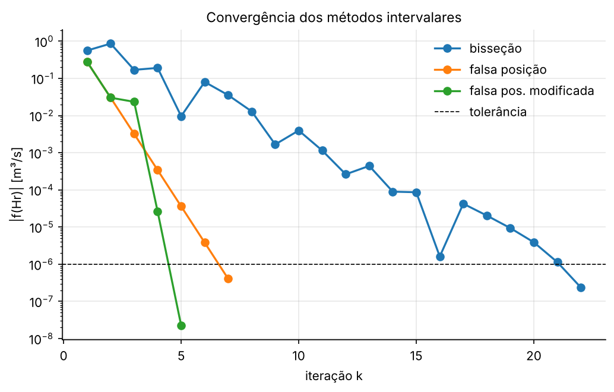

# AP 01 — Métodos da Bisseção e da Falsa Posição

**Problema:** profundidade normal $H$ de um canal retangular aberto em escoamento uniforme.

## Resumo operacional

Para uma vazão conhecida $Q$, a equação semi-empírica de Manning relaciona $Q$ com a profundidade $H$ de forma não linear:

$$Q = \frac{S^{1/2}}{n}\,\frac{(BH)^{5/3}}{(B+2H)^{2/3}} \quad\Longrightarrow\quad f(H) = \frac{S^{1/2}}{n}\,\frac{(BH)^{5/3}}{(B+2H)^{2/3}} - Q = 0$$

A raiz de $f(H)$ é a profundidade em que a vazão de Manning é igual à vazão prescrita. Ela é obtida por dois **métodos intervalares**, bisseção e falsa posição. Depois, a velocidade média sai de $U = Q/(BH)$.

## Algoritmos

Os dois métodos partem de $[H_l, H_u]$ com $f(H_l)\,f(H_u) < 0$ e, a cada iteração, escolhem um ponto $H_r$ dentro do intervalo. A diferença está na forma de escolher esse ponto:

| Método | Nova aproximação $H_r$ |
|---|---|
| Bisseção | $H_r = (H_l + H_u)/2$ |
| Falsa posição | $H_r = H_u - f(H_u)\,\dfrac{H_l - H_u}{f(H_l) - f(H_u)}$ |

Depois de calcular $H_r$, o intervalo é atualizado: se $f(H_l)f(H_r) < 0$, faz-se $H_u = H_r$; senão, $H_l = H_r$. A parada acontece quando $|f(H_r)| < 10^{-6}$, ou ao atingir o limite de iterações.

As funções usadas são `bissecao`, `falsa_posicao` e `falsa_posicao_modificada`, de [`utils/raizes.py`](../../utils/raizes.py).

## Dicionário de variáveis

| Variável | Significado | Unidade | Tipo |
|---|---|---|---|
| `S` | inclinação do canal | – | float |
| `B` | largura do canal | m | float |
| `N_MANNING` | coeficiente de rugosidade de Manning | s/m^(1/3) | float |
| `Q` | vazão volumétrica prescrita | m³/s | float |
| `H_L`, `H_U` | limites do intervalo inicial | m | float |
| `TOL` | tolerância do critério $\lvert f(H_r)\rvert$ | m³/s | float |
| `MAX_ITER` | limite de iterações | – | int |
| `H_bis`, `H_fp` | profundidade encontrada por cada método | m | float |
| `hist_bis`, `hist_fp` | histórico das iterações (k, Hl, Hu, Hr, f(Hr)) | – | list[dict] |
| `U_bis`, `U_fp` | velocidade média | m/s | float |

## Dependências, I/O e execução

- **Dependências:** Python 3, `numpy` (vetores) e `matplotlib` (gráficos).
- **Entradas:** constantes no bloco `DADOS DE ENTRADA` do `main.py`.
- **Saídas** (em `outputs/`):
  - `resultados.txt`: tabelas de iterações e comparação
  - `funcao_manning.png`: método gráfico
  - `convergencia.png`: $\lvert f\rvert$ por iteração

Para executar, a partir da raiz do repositório:

```bash
python Aulas_Praticas/AP01_Bissecao_FalsaPosicao/main.py
```

## Resultados e validação

| Método | $H$ [m] | Iterações | $U$ [m/s] |
|---|---|---|---|
| Bisseção | 0,702293 | 22 | 0,355977 |
| Falsa posição | 0,702293 | 7 | 0,355977 |
| Falsa posição modificada | 0,702293 | 5 | 0,355977 |

A validação foi feita de três formas:

- Os dois métodos concordam até $5{,}6\times10^{-8}$ m.
- O resultado bate com o valor de referência $H = 0{,}7023$ m dado em sala.
- Substituindo $H$ de volta em Manning, a vazão volta a $5{,}000000$ m³/s, porque o resíduo é menor que $10^{-6}$.



## Respostas às questões

**a) Os dois métodos convergiram para a mesma profundidade?**
Sim, para $H = 0{,}702293$ m. A diferença entre eles ($\sim 6\times10^{-8}$ m) fica abaixo do que a tolerância consegue distinguir.

**b) Qual precisou de menos iterações?**
A falsa posição, com 7 iterações contra 22 da bisseção. A função é suave e quase linear perto da raiz, então a reta secante aponta muito perto do zero.

**c) Qual a diferença na escolha de $H_r$?**
A bisseção usa só os sinais e sempre corta o intervalo ao meio, sem olhar os valores de $f$. A falsa posição usa os *valores* de $f$: interpola uma reta entre os extremos, e a nova aproximação cai mais perto do extremo com menor $\lvert f\rvert$. Por outro lado, ela pode "travar" um extremo. Aqui $H_u = 1$ ficou fixo em todas as iterações. A versão modificada corrige isso dividindo por 2 o $f$ do extremo preso, e cai para 5 iterações.

**d) Por que são métodos intervalares?**
Porque trabalham sempre com um intervalo $[H_l, H_u]$ que contém a raiz e só o encolhem, sem nunca deixar a raiz escapar. Por isso a convergência é garantida para $f$ contínua, ao contrário dos métodos abertos.

**e) Papel da condição $f(H_l)f(H_u) < 0$?**
No início, ela garante pelo Teorema de Bolzano que existe pelo menos uma raiz no intervalo. Durante as iterações, é o teste que decide qual metade (ou parte) do intervalo descartar: o algoritmo mantém essa troca de sinal como invariante.

**f) Compare as velocidades.**
$U = 0{,}355977$ m/s nos dois métodos. A diferença está na 8ª casa decimal, porque $U$ herda o erro relativo de $H$.

## Bibliografia específica

- CHAPRA, S. C.; CANALE, R. P. *Métodos numéricos para engenharia*. 7. ed. AMGH, 2016. Cap. 5 (métodos intervalares).
- CHOW, V. T. *Open-channel hydraulics*. McGraw-Hill, 1959 (equação de Manning).
