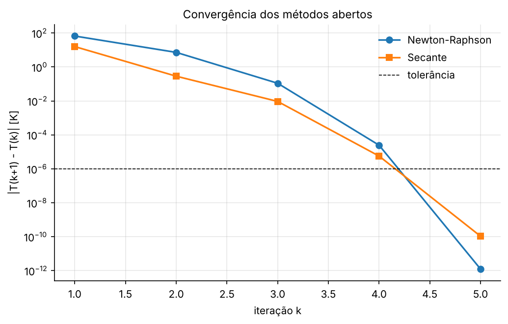

# AP 02 — Métodos de Newton-Raphson e da Secante

**Problema:** temperatura de equilíbrio de uma pequena superfície aquecida que perde calor por convecção e radiação.

## Resumo operacional

Em regime permanente, a potência recebida é igual à soma das perdas:

$$P = hA(T - T_\infty) + \varepsilon\sigma A(T^4 - T_\infty^4) \;\Longrightarrow\; f(T) = hA(T-T_\infty) + \varepsilon\sigma A(T^4 - T_\infty^4) - P = 0$$

O termo de radiação ($T^4$) torna a equação não linear. O problema é resolvido de duas formas:

1. **Newton-Raphson**, com a derivada analítica $f'(T) = hA + 4\varepsilon\sigma A T^3$.
2. **Secante**, tratando $f$ como "caixa-preta" (como se viesse de um experimento ou de outro programa), sem usar $f'$.

## Algoritmos

| Método | Atualização | Precisa de |
|---|---|---|
| Newton-Raphson | $T_{k+1} = T_k - \dfrac{f(T_k)}{f'(T_k)}$ | $f$ e $f'$, 1 chute |
| Secante | $T_{k+1} = T_k - f(T_k)\,\dfrac{T_k - T_{k-1}}{f(T_k) - f(T_{k-1})}$ | só $f$, 2 chutes |

A parada usa $\lvert T_{k+1} - T_k\rvert < 10^{-6}$ K, com limite de 50 iterações. As funções vêm de [`utils/raizes.py`](../../utils/raizes.py): `newton_raphson` e `secante`.

## Dicionário de variáveis

| Variável | Significado | Unidade | Tipo |
|---|---|---|---|
| `AREA` | área da superfície $A$ | m² | float |
| `H_CONV` | coeficiente de convecção $h$ | W/(m² K) | float |
| `EMISSIVIDADE` | emissividade $\varepsilon$ | – | float |
| `T_INF` | temperatura ambiente $T_\infty$ | K | float |
| `POTENCIA` | potência recebida $P$ | W | float |
| `SIGMA` | constante de Stefan-Boltzmann | W/(m² K⁴) | float |
| `T0_NEWTON` | chute inicial do Newton | K | float |
| `T0_SEC`, `T1_SEC` | chutes da secante | K | float |
| `TOL`, `MAX_ITER` | tolerância e limite de iterações | K, – | float, int |
| `T_newton`, `T_sec` | temperatura de equilíbrio encontrada | K | float |

## Dependências, I/O e execução

- **Dependências:** `numpy` e `matplotlib`.
- **Entradas:** bloco `DADOS DE ENTRADA` do `main.py`.
- **Saídas** em `outputs/`:
  - `resultados.txt`: conferência da Tabela 1, iterações e balanço de energia
  - `funcao_residuo.png`
  - `convergencia.png`

```bash
python Aulas_Praticas/AP02_Newton_Secante/main.py
```

## Resultados e validação

| Método | $T$ [K] | Iterações |
|---|---|---|
| Newton-Raphson ($T_0 = 350$ K) | 409,361573 | 5 |
| Secante ($T_0 = 400$, $T_1 = 425$ K) | 409,361573 | 5 |

A validação foi feita de três formas:

- A rotina reproduz exatamente os valores da Tabela 1 do enunciado.
- Os dois métodos convergem para o mesmo valor, até a precisão de máquina.
- O balanço de energia fecha: convecção 10,9362 W mais radiação 9,0638 W dá 20,0000 W, que é igual a $P$.



Na tabela do Newton dá para ver a **convergência quadrática**: o erro cai de 7,3 para 0,11, depois para 2,5×10⁻⁵ e para 1,3×10⁻¹². A cada passo o número de casas corretas praticamente dobra.

## Respostas às questões

**a) Convergiram para a mesma temperatura?**
Sim, $T = 409{,}361573$ K (cerca de 136 °C).

**b) Qual precisou de menos iterações?**
Empataram em 5. O Newton partiu de um chute mais distante (350 K), e a secante partiu de dois pontos que já cercavam a raiz. Em ordem de convergência o Newton é melhor (quadrática, ordem 2) que a secante (superlinear, ordem ≈ 1,618). Por outro lado, cada iteração do Newton custa uma avaliação de $f$ e uma de $f'$, enquanto a secante custa só uma avaliação nova de $f$.

**c) Por que o Newton precisa de $f'(T)$?**
Porque ele troca a função pela sua reta tangente em $T_k$, e a nova aproximação é onde essa tangente cruza o eixo. A inclinação da tangente é $f'(T_k)$.

**d) Vantagem da secante quando $f$ vem de experimento, simulação ou programa externo?**
Ela só precisa de valores de $f$. A derivada não é necessária, e nesses casos ela costuma não existir em forma analítica (ou é ruidosa, cara ou inacessível).

**e) Em que sentido a secante é uma modificação do Newton?**
É a mesma fórmula do Newton com a derivada trocada por uma diferença finita feita com os dois últimos pontos: $f'(T_k) \approx [f(T_k) - f(T_{k-1})]/(T_k - T_{k-1})$. A tangente vira uma secante. À medida que os pontos se aproximam, a secante tende à tangente.

## Bibliografia específica

- CHAPRA, S. C.; CANALE, R. P. *Métodos numéricos para engenharia*. 7. ed. AMGH, 2016. Cap. 6 (métodos abertos).
- INCROPERA, F. P. et al. *Fundamentos de transferência de calor e de massa*. 7. ed. LTC, 2014. Cap. 1 (balanço com convecção e radiação).
