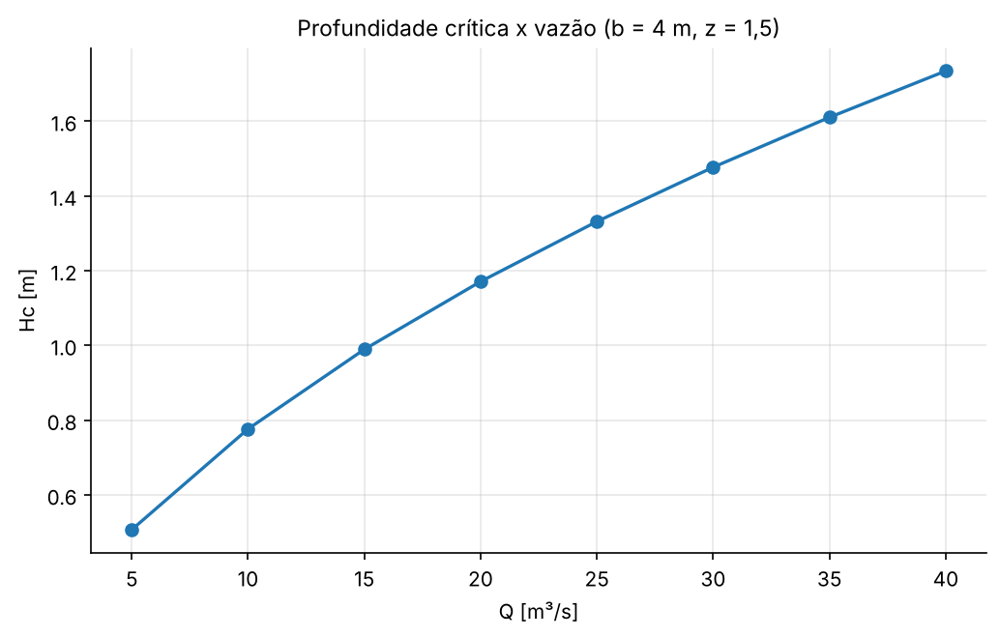

# AP 03 — Método de Müller: profundidade crítica em canal trapezoidal

## Resumo operacional

Um canal trapezoidal tem fundo de largura $b$ e talude $z:1$. O escoamento é **crítico** quando o número de Froude vale 1, ou seja, quando os efeitos inerciais e gravitacionais estão em equilíbrio:

$$Fr^2 = \frac{Q^2\,T}{g\,A^3} = 1, \qquad A(H) = bH + zH^2, \qquad T(H) = b + 2zH$$

### Formulação (Parte 1, feita no papel)

Multiplicando a condição por $gA^3$, ela fica:

$$g\,(bH + zH^2)^3 - Q^2\,(b + 2zH) = 0$$

Expandindo $(bH + zH^2)^3 = H^3(b + zH)^3$, chega-se ao polinômio de 6ª ordem:

$$f(H) = g z^3 H^6 + 3 g b z^2 H^5 + 3 g b^2 z H^4 + g b^3 H^3 - 2 Q^2 z H - Q^2 b = 0$$

| Coeficiente | Expressão | Valor ($Q = 20$) |
|---|---|---|
| $a_6$ | $g z^3$ | 33,10875 |
| $a_5$ | $3 g b z^2$ | 264,87 |
| $a_4$ | $3 g b^2 z$ | 706,32 |
| $a_3$ | $g b^3$ | 627,84 |
| $a_2$ | 0 | 0 |
| $a_1$ | $-2 Q^2 z$ | −1200 |
| $a_0$ | $-Q^2 b$ | −1600 |

O termo em $H^2$ é nulo porque $A^3$ só tem potências de $H^3$ a $H^6$, e $T$ só tem $H^0$ e $H^1$.

## Algoritmo (método de Müller)

Com três aproximações $H_0, H_1, H_2$, o método segue estes passos:

1. Calcula os passos $h_0 = H_1 - H_0$ e $h_1 = H_2 - H_1$.
2. Calcula as inclinações das secantes: $\delta_0 = (f_1 - f_0)/h_0$ e $\delta_1 = (f_2 - f_1)/h_1$.
3. Monta a parábola: $a = (\delta_1 - \delta_0)/(h_1 + h_0)$, $b_M = a h_1 + \delta_1$ e $c = f_2$.
4. Calcula $D = \sqrt{b_M^2 - 4ac}$ (raiz complexa, se for preciso). Escolhe $E = b_M \pm D$ com o **maior módulo**.
5. Atualiza: $H_3 = H_2 - 2c/E$.
6. Descarta o ponto mais antigo, $(H_0, H_1, H_2) \leftarrow (H_1, H_2, H_3)$, e repete até $\lvert H_3 - H_2\rvert < 10^{-8}$ m.

A função usada é `muller`, de [`utils/raizes.py`](../../utils/raizes.py). O polinômio é avaliado por Horner (`avaliar_polinomio`, de [`utils/polinomios.py`](../../utils/polinomios.py)).

## Dicionário de variáveis

| Variável | Significado | Unidade | Tipo |
|---|---|---|---|
| `B_FUNDO` | largura de fundo $b$ | m | float |
| `Z_TALUDE` | inclinação lateral $z$ | – | float |
| `G` | aceleração da gravidade | m/s² | float |
| `Q_TESTE` | vazão do teste inicial | m³/s | float |
| `H_INICIAIS` | aproximações iniciais $(H_0, H_1, H_2)$ | m | tuple |
| `TOL`, `MAX_ITER` | critério de parada e limite de iterações | m, – | float, int |
| `VAZOES` | vazões da varredura | m³/s | list |
| `coef` | coeficientes $[a_0, \dots, a_6]$ (ordem crescente) | – | list |
| `Hc` | profundidade crítica | m | float |

## Dependências, I/O e execução

- **Dependências:** `numpy` e `matplotlib`.
- **Saídas** em `outputs/`:
  - `resultados.txt`
  - `Hc_vs_Q.txt`: duas colunas, Q e Hc
  - `Hc_vs_Q.png`
  - `polinomio.png`

```bash
python Aulas_Praticas/AP03_Muller_Canal_Critico/main.py
```

## Resultados e validação

- Para $Q = 20$ m³/s: $H_c = 1{,}17104548$ m em 5 iterações.
- Verificação física: $A_c = 6{,}741$ m², $T_c = 7{,}513$ m e $Fr^2 = 1{,}000000000000$.
- Validação cruzada: o Bairstow, aplicado ao mesmo polinômio, encontra a mesma raiz positiva.

| Q [m³/s] | 5 | 10 | 15 | 20 | 25 | 30 | 35 | 40 |
|---|---|---|---|---|---|---|---|---|
| Hc [m] | 0,5071 | 0,7766 | 0,9895 | 1,1710 | 1,3316 | 1,4769 | 1,6104 | 1,7344 |



## Respostas às questões

**a) Profundidade crítica para $Q = 20$ m³/s?**
$H_c = 1{,}171045$ m.

**b) A solução satisfaz $Fr \approx 1$?**
Sim, $Fr^2 = 1$ até a 12ª casa decimal.

**c) Por que um polinômio de 6ª ordem?**
Porque a área molhada é quadrática em $H$, e ela aparece ao cubo na condição crítica: $A^3 \propto H^6$. Ao multiplicar tudo por $gA^3$ para tirar o denominador, o grau sobe para 6.

**d) Por que nem toda raiz serve?**
As 6 raízes são:

- $1{,}1710$, real e positiva: a única admissível.
- $-1{,}4826$, real mas negativa.
- Dois pares complexos conjugados: $-0{,}428 \pm 1{,}422i$ e $-3{,}416 \pm 0{,}975i$.

Uma profundidade precisa ser real e positiva. As outras raízes são soluções matemáticas do polinômio, sem significado físico.

**e) O que acontece com $H_c$ quando $Q$ aumenta?**
$H_c$ cresce, de forma côncava (perto de $Q^{2/3}$, como no canal retangular, onde $H_c = (Q^2/(g b^2))^{1/3}$). É coerente: para transportar mais vazão em regime crítico, é preciso mais área e, portanto, mais profundidade.

**f) Outras aproximações iniciais convergem para a mesma raiz?**
Não necessariamente:

| $(H_0, H_1, H_2)$ | Raiz encontrada | Iterações |
|---|---|---|
| (0,5; 1,0; 1,5) | 1,171045 (física) | 5 |
| (0,1; 0,2; 0,3) | −1,482600 (negativa) | 6 |
| (2,0; 3,0; 4,0) | −0,4279 − 1,4221i (complexa) | 14 |
| (−3,0; −2,5; −2,0) | −1,482600 (negativa) | 5 |

O Müller converge para a raiz "atraída" pela parábola local. Como usa raiz quadrada complexa, ele pode até ir para raízes complexas. Na prática, convém chutar perto da raiz física. Uma boa estimativa vem do canal retangular equivalente: $H \approx (Q^2/(g b^2))^{1/3} = 1{,}37$ m.

**g) Função dos três pontos e diferença para a secante?**
Três pontos definem uma **parábola** que interpola $f$ localmente e captura a curvatura. A secante usa dois pontos e uma **reta**. Por isso o Müller converge mais rápido (ordem ≈ 1,84 contra 1,62) e, como a parábola pode ter raízes complexas, consegue achar raízes complexas.

**h) Por que escolher o denominador de maior módulo?**
Quando $4ac$ é pequeno, $D \approx \lvert b_M\rvert$, e a soma $b_M \pm D$ com sinais opostos subtrai dois números quase iguais. Isso é **cancelamento subtrativo**, que perde algarismos significativos. Escolher o maior módulo evita o cancelamento e, de quebra, dá a menor correção $\lvert\Delta H\rvert$, isto é, a raiz da parábola mais próxima de $H_2$.

## Bibliografia específica

- CHAPRA, S. C.; CANALE, R. P. *Métodos numéricos para engenharia*. 7. ed. AMGH, 2016. Seção 7.4 (método de Müller).
- CHOW, V. T. *Open-channel hydraulics*. McGraw-Hill, 1959 (escoamento crítico).
