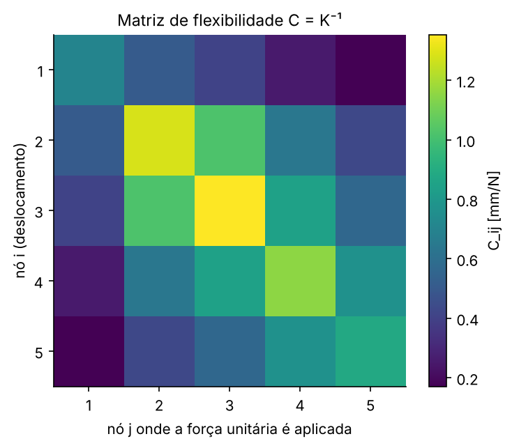

# AP 07 — Inversão matricial por decomposição LU: matriz de flexibilidade

## Resumo operacional

Numa cadeia de nós ligados por molas, o equilíbrio estático é $F = Ku$, em que $K$ é a matriz de **rigidez** (N/m). A inversa $C = K^{-1}$ é a matriz de **flexibilidade** ou complacência (m/N): $u = CF$. O objetivo é calcular $C$ inteira, sem rotina pronta de inversão, usando uma única decomposição LU.

Para a cadeia parede–$k_0$–nó 1–$k_1$–nó 2–…–nó $n$–$k_n$–parede:

$$K = \begin{bmatrix} k_0+k_1 & -k_1 & & \\ -k_1 & k_1+k_2 & -k_2 & \\ & \ddots & \ddots & \ddots \\ & & -k_{n-1} & k_{n-1}+k_n \end{bmatrix}$$

## Algoritmo

1. **Decompõe uma única vez** $K = LU$ (Doolittle). A eliminação gaussiana guarda os multiplicadores em $L$.
2. Para cada coluna $j = 1..n$:
   - monta $e_j$, a coluna $j$ da identidade;
   - resolve $Ly = e_j$ por substituição **progressiva**;
   - resolve $Uc_j = y$ por substituição **regressiva**;
   - guarda $c_j$ como a coluna $j$ de $C$.
3. Verifica $\max\lvert KC - I\rvert$ e a simetria $\max\lvert C_{ij} - C_{ji}\rvert$.
4. Usa $C$: o deslocamento para qualquer carga é $u = CF$, uma multiplicação matriz-vetor.

As funções vêm de [`utils/sistemas_lineares.py`](../../utils/sistemas_lineares.py): `decomposicao_lu`, `inversa_lu` e `resolver_lu`.

## Dicionário de variáveis

| Variável | Significado | Unidade | Tipo |
|---|---|---|---|
| `RIGIDEZ_2GDL`, `RIGIDEZ_5GDL` | rigidezes $[k_0, \dots, k_n]$ | N/m | list |
| `CARREGAMENTO` | vetor de forças externas $F$ | N | array |
| `K` | matriz de rigidez | N/m | array n×n |
| `L`, `U` | fatores da decomposição LU | –, N/m | array n×n |
| `C` | matriz de flexibilidade $K^{-1}$ | m/N | array n×n |
| `u` | deslocamentos nodais | m | array |

## Dependências, I/O e execução

- **Dependências:** `numpy` e `matplotlib`.
- **Saídas** em `outputs/`:
  - `resultados.txt`
  - `matriz_flexibilidade.txt`: $C$ em m/N
  - `matriz_flexibilidade.png`

```bash
python Aulas_Praticas/AP07_Inversao_LU_Molas/main.py
```

## Resultados e validação

**2 GDL (feito também no papel):** $K = \begin{bmatrix}1500 & -500\\-500 & 1500\end{bmatrix}$ e $\det K = 2\times10^6$, portanto:

$$C = \frac{1}{\det K}\begin{bmatrix}1500 & 500\\500 & 1500\end{bmatrix} = \begin{bmatrix}7{,}5 & 2{,}5\\2{,}5 & 7{,}5\end{bmatrix}\times10^{-4}\ \text{m/N}$$

A LU reproduz exatamente esse resultado, com $\max\lvert KC - I\rvert = 8\times10^{-18}$.

**5 GDL:** $\max\lvert LU - K\rvert = 0$, $\max\lvert KC - I\rvert = 5{,}6\times10^{-16}$ e $\max\lvert C - C^T\rvert = 10^{-19}$ m/N.

$$C = \begin{bmatrix} 0{,}7051 & 0{,}5128 & 0{,}4103 & 0{,}2564 & 0{,}1709\\ & 1{,}2821 & 1{,}0256 & 0{,}6410 & 0{,}4274\\ & & 1{,}3538 & 0{,}8462 & 0{,}5641\\ & \text{sim.} & & 1{,}1538 & 0{,}7692\\ & & & & 0{,}8832\end{bmatrix}\ \text{mm/N}$$

Para $F = [0, 100, 0, -50, 25]$ N, o resultado é $u = [42{,}74;\ 106{,}84;\ 74{,}36;\ 25{,}64;\ 26{,}35]$ mm. Ele coincide com a solução direta de $Ku = F$ (diferença de $10^{-17}$ m).



## Respostas às questões

**a) Diferença física entre $K$ e $C$?**
$K$ diz **quanta força** é preciso aplicar para impor um deslocamento (rigidez, N/m). $C$ diz **quanto a estrutura se desloca** sob uma força (flexibilidade, m/N). Uma é a inversa da outra.

**b) O que é a coluna $j$ de $C$?**
O vetor de deslocamentos de **todos** os nós quando se aplica uma força unitária (1 N) **apenas no nó $j$**. Esses são os coeficientes de influência.

**c) Por que não repetir a LU para cada coluna?**
Porque $L$ e $U$ dependem só de $K$, que é a mesma para todas as colunas. O que muda é apenas o lado direito $e_j$.

**d) Vantagem computacional?**
A decomposição custa $\sim 2n^3/3$ e é feita uma vez. Cada coluna custa só duas substituições, $\sim 2n^2$. O total fica $\sim 8n^3/3$, contra $\sim 2n^4/3$ se a eliminação inteira fosse repetida para cada uma das $n$ colunas.

**e) Por que $C$ é simétrica?**
Porque $K$ é simétrica: a mola entre $i$ e $j$ age igualmente nos dois nós, então $k_{ij} = k_{ji}$. A inversa de uma matriz simétrica é simétrica: $(K^{-1})^T = (K^T)^{-1} = K^{-1}$. Fisicamente, é a **reciprocidade de Maxwell-Betti**: o deslocamento em $i$ causado por 1 N em $j$ é igual ao deslocamento em $j$ causado por 1 N em $i$.

**f) E se uma mola ficar muito pouco rígida?**
Com $k_2$ (a 3ª mola, entre os nós 2 e 3) passando de 1500 para 1 N/m, a cadeia praticamente se divide em dois blocos. Os termos que ligam os nós 1–2 aos nós 3–5 caem para ~0,001–0,005 mm/N: uma força num lado quase não move o outro. Já os termos diagonais crescem (por exemplo, $C_{33}$ vai de 1,35 para 2,66 mm/N), porque a estrutura fica mais flexível.

**g) Sem as paredes, daria para inverter $K$?**
Não. Sem apoios, um deslocamento de corpo rígido (todos os nós iguais, $u = [1,1,1,1,1]$) não gera força nenhuma: $Ku = 0$. Isso torna $K$ **singular** ($\det K = 0$). Fisicamente, qualquer resultante de forças não nula aceleraria a cadeia, e não existe equilíbrio estático único. O programa confirma: o último pivô da LU dá exatamente zero.

**h) Vantagem de conhecer $C$ para muitos carregamentos?**
Cada novo caso de carga custa só $u = CF$ ($n^2$ multiplicações), sem refazer nenhuma fatoração. Além disso, $C$ mostra direto quais nós são mais sensíveis (diagonal maior) e como as cargas se propagam (fora da diagonal).

## Bibliografia específica

- CHAPRA, S. C.; CANALE, R. P. *Métodos numéricos para engenharia*. 7. ed. AMGH, 2016. Seções 10.1–10.2 (LU e inversa) e 12.4 (sistemas massa-mola).
