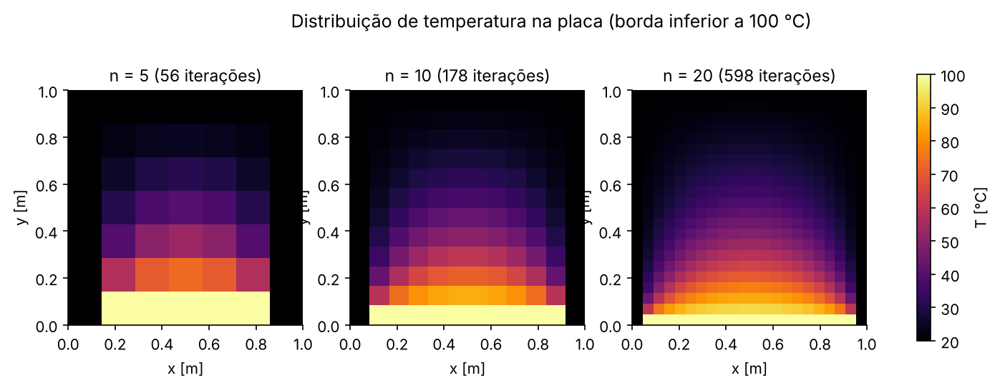
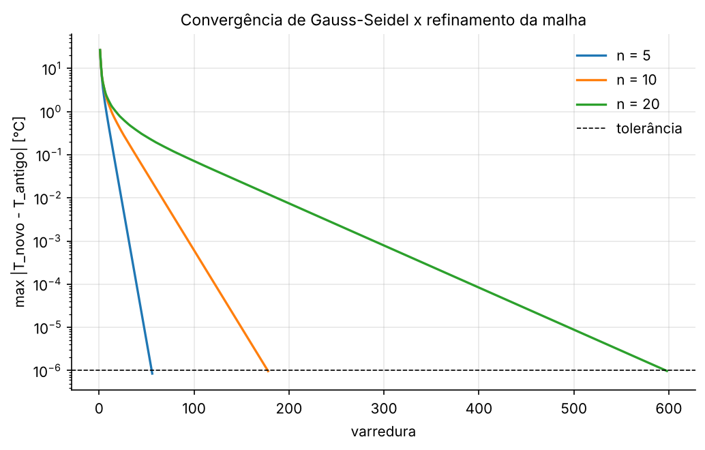

# AP 08 — Método de Gauss-Seidel: condução de calor em uma placa

## Resumo operacional

Uma placa quadrada de lado $L = 1$ m conduz calor em regime permanente, sem geração interna. A borda inferior é mantida a 100 °C e as outras três a 20 °C. A equação governante é a de Laplace:

$$\frac{\partial^2 T}{\partial x^2} + \frac{\partial^2 T}{\partial y^2} = 0$$

Numa malha uniforme ($\Delta x = \Delta y$), as diferenças centrais transformam a EDP numa equação algébrica para cada nó interno:

$$T_{i,j} = \frac{T_{i-1,j} + T_{i+1,j} + T_{i,j-1} + T_{i,j+1}}{4}$$

A temperatura de cada nó é a média dos quatro vizinhos. O conjunto dessas equações é um sistema linear com $n^2$ incógnitas. Ele é resolvido por **Gauss-Seidel aplicado direto na malha** (método de Liebmann), sem montar a matriz.

> Esta pasta substitui o arquivo `#PPC SURPRESA.py`. O original tinha um bug: `np.full((n+2, n+2), 20)` cria uma matriz de **inteiros**, e cada média era truncada. Por isso ele "convergia" em 14 iterações, com o centro a 34 °C e o mesmo número de iterações para n = 10 e n = 20. Com `dtype=float`, os resultados abaixo são os corretos.

## Algoritmo

```
T = matriz (n+2)x(n+2) em float, interior = 20, borda inferior = 100
repita até erro < tol ou iter = max_iter:
    erro = 0
    para j = 2..n+1 (vertical), i = 2..n+1 (horizontal):
        antigo = T(i,j)
        T(i,j) = [T(i-1,j) + T(i+1,j) + T(i,j-1) + T(i,j+1)] / 4   (já usa os valores novos)
        erro = max(erro, |T(i,j) - antigo|)
```

O critério de parada é a maior variação entre duas varreduras, menor que $10^{-6}$ °C. Depois da convergência, o programa confere o resíduo das equações discretizadas: $r_{ij} = 4T_{ij} - \sum \text{vizinhos}$.

A função usada é `gauss_seidel_laplace_2d`, de [`utils/edp.py`](../../utils/edp.py). Ela aceita também uma relaxação $\lambda$ (SOR) e um termo fonte $q'''\Delta x^2/k$, que serão usados nos exemplos de processador.

**Convenção de índices:** `T[i, j]`, com `i` na direção $x$ e `j` na direção $y$; `j = 0` é a borda de baixo, como no pseudocódigo. Para desenhar a placa na orientação física, usa-se `imshow(T.T, origin="lower")`.

## Dicionário de variáveis

| Variável | Significado | Unidade | Tipo |
|---|---|---|---|
| `T_INFERIOR`, `T_OUTRAS` | temperaturas das bordas | °C | float |
| `TOL`, `MAX_ITER` | critério de parada e limite de varreduras | °C, – | float, int |
| `MALHAS` | valores de $n$ (nós internos por direção) | – | list |
| `T` | matriz de temperaturas $(n+2)\times(n+2)$, com as bordas | °C | array float |
| `erros` | maior variação de cada varredura | °C | list |

## Dependências, I/O e execução

- **Dependências:** `numpy` e `matplotlib`.
- **Saídas** em `outputs/`:
  - `resultados.txt`
  - `temperaturas_n5.txt`, `temperaturas_n10.txt`, `temperaturas_n20.txt`: matriz completa, com as bordas
  - `campos_temperatura.png`
  - `convergencia.png`

```bash
python Aulas_Praticas/AP08_Gauss_Seidel_Placa/main.py
```

## Resultados e validação

| $n$ | Iterações | Erro final [°C] | $\max\lvert r_{ij}\rvert$ [°C] |
|---|---|---|---|
| 5 | 56 | 8,5×10⁻⁷ | 1,7×10⁻⁶ |
| 10 | 178 | 9,7×10⁻⁷ | 1,9×10⁻⁶ |
| 20 | 598 | 9,8×10⁻⁷ | 1,9×10⁻⁶ |

O nó central $T(4,4)$ para $n = 5$ vale **39,999997 °C**.

**Validação por simetria (superposição).** Imagine quatro problemas iguais, cada um com uma borda diferente a 100 °C. Somando os quatro, cada borda fica a $100 + 20 + 20 + 20$, ou seja, a temperatura é uniforme. Como as quatro rotações dão o mesmo valor no centro, o centro de *um* deles vale $(100 + 20 + 20 + 20)/4 = 40$ °C. Esse resultado vale tanto para a equação contínua quanto para a malha discreta simétrica. O valor numérico (39,999997 °C) bate com essa referência dentro da tolerância.




## Respostas às questões

As respostas também estão nos comentários do final do `main.py`, como pede o enunciado.

**a) Por que as bordas não são atualizadas?**
São condições de contorno de Dirichlet, temperaturas impostas. Elas não são incógnitas: entram só como dados nas equações dos nós vizinhos.

**b) Gauss-Seidel x Jacobi?**
O Jacobi usa apenas valores da varredura anterior (precisa de uma cópia da matriz). O Gauss-Seidel usa cada valor novo imediatamente, na mesma matriz. Assim a informação se propaga mais rápido, a convergência leva em geral cerca de metade das iterações e gasta menos memória.

**c) Como o número de iterações muda com o refinamento?**
Cresce aproximadamente com $n^2$: 56, depois 178, depois 598. Cada varredura só leva a informação de um nó para o vizinho, e o raio espectral da iteração se aproxima de 1 quando a malha fica mais fina. Como cada varredura custa $n^2$ operações, o custo total cresce perto de $n^4$. A sobre-relaxação (SOR, $1 < \lambda < 2$) reduz muito esse número; veja o exemplo E03 em `Exemplos_Processador/`.

## Bibliografia específica

- CHAPRA, S. C.; CANALE, R. P. *Métodos numéricos para engenharia*. 7. ed. AMGH, 2016. Seção 11.2 (Gauss-Seidel) e cap. 29 (equação de Laplace, método de Liebmann).
- INCROPERA, F. P. et al. *Fundamentos de transferência de calor e de massa*. 7. ed. LTC, 2014. Cap. 4 (condução bidimensional).
