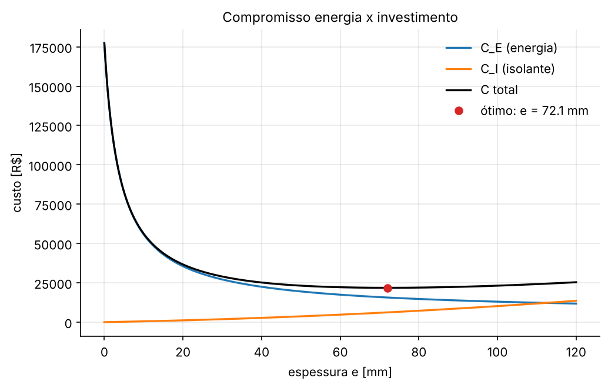

# AP 09 — Otimização unidimensional: espessura ótima de isolamento térmico

## Resumo operacional

Uma tubulação quente recebe uma camada de isolante de espessura $e$. Mais isolante custa mais caro para instalar, mas economiza energia ao longo da operação. O objetivo é achar a espessura que **minimiza o custo total** no período considerado.

A condução radial no isolante e a convecção externa funcionam como duas resistências em série:

$$R'_{cond} = \frac{\ln[(r_1+e)/r_1]}{2\pi k}, \qquad R'_{conv} = \frac{1}{2\pi h(r_1+e)}, \qquad q'(e) = \frac{T_i - T_\infty}{R'_{cond} + R'_{conv}}$$

Os custos são:

$$C_E(e) = p_E\,\frac{L\,q'(e)\,t}{1000}, \qquad C_I(e) = c_I\,\pi L\left[(r_1+e)^2 - r_1^2\right], \qquad C(e) = C_E + C_I$$

O problema é minimizar $C(e)$ com $0 \le e \le 0{,}12$ m, sem usar derivadas analíticas.

## Algoritmos

**Razão áurea.** Os pontos internos são $x_1 = b - \tau(b-a)$ e $x_2 = a + \tau(b-a)$, com $\tau = (\sqrt5 - 1)/2$:

- se $C(x_1) > C(x_2)$, descarta-se $[a, x_1]$;
- senão, descarta-se $[x_2, b]$.

O ponto interno que sobra é reaproveitado, então cada iteração custa **uma** avaliação nova. A parada é $\lvert b - a\rvert < 10^{-6}$ m.

**Interpolação quadrática.** Uma parábola passa pelos três pontos, montada por diferenças divididas:

$$d_1 = \frac{f_2 - f_1}{x_2 - x_1}, \quad A = \frac{\frac{f_3 - f_2}{x_3 - x_2} - d_1}{x_3 - x_1}, \quad B = d_1 - A(x_1 + x_2), \quad x_{novo} = -\frac{B}{2A}$$

A tripla é atualizada pelas quatro regras do enunciado.

Há **proteções** para os casos ruins: se $A \le 0$, se o vértice cai fora de $(x_1, x_3)$ ou se praticamente coincide com um ponto existente, o método dá um passo de razão áurea no maior subintervalo. A parada é $x_3 - x_1 < 10^{-6}$ m.

As funções vêm de [`utils/otimizacao.py`](../../utils/otimizacao.py): `razao_aurea`, `interpolacao_quadratica` e `FuncaoContada`. Esta última conta as avaliações efetivamente feitas.

## Dicionário de variáveis

| Variável | Significado | Unidade | Tipo |
|---|---|---|---|
| `R1` | raio externo do tubo sem isolamento | m | float |
| `L_TUBO` | comprimento da tubulação | m | float |
| `T_I`, `T_INF` | temperatura da interface e do ambiente | °C | float |
| `K_ISOL` | condutividade do isolante | W/(m K) | float |
| `H_EXT` | coeficiente de convecção externa | W/(m² K) | float |
| `TEMPO` | tempo acumulado de operação | h | float |
| `P_ENERGIA` | preço da energia térmica | R$/kWh | float |
| `C_ISOLANTE` | custo instalado do isolante | R$/m³ | float |
| `E_MIN`, `E_MAX` | intervalo admissível da espessura | m | float |
| `PONTOS_QUADRATICA` | tripla inicial $(x_1, x_2, x_3)$ | m | tuple |
| `e_aurea`, `e_quad` | espessura ótima encontrada | m | float |

## Dependências, I/O e execução

- **Dependências:** `numpy` e `matplotlib`.
- **Saídas** em `outputs/`:
  - `resultados.txt`
  - `custos.png`: $C_E$, $C_I$ e $C$ em função de $e$
  - `e_otima_vs_preco.png`

```bash
python Aulas_Praticas/AP09_Otimizacao_Isolamento/main.py
```

## Resultados

**Exploração (item 4):** $C$ cai de R$ 177 337 ($e = 0$) para cerca de R$ 21 950 perto de $e = 0{,}08$ m e volta a subir. O mínimo está na região de 0,06 a 0,08 m.

| Resultado | Razão áurea | Interpolação quadrática |
|---|---|---|
| Espessura ótima | 0,0720644 m | 0,0720642 m |
| Custo mínimo | R$ 21 827,17 | R$ 21 827,17 |
| Iterações | 25 | 15 |
| Avaliações de $C(e)$ | **27** | **18** |
| Parada | $\lvert b-a\rvert < 10^{-6}$ | $x_3 - x_1 < 10^{-6}$ (9 passos de proteção) |

O número de **avaliações** é a medida justa de custo. Num projeto real, cada avaliação de $C(e)$ pode ser uma simulação inteira (CFD, elementos finitos), muito mais cara que a "aritmética" do próprio otimizador.

**Estudo paramétrico (item 10):**

| $p_E$ [R$/kWh] | 0,35 | 0,70 | 1,05 | 1,40 |
|---|---|---|---|---|
| $e_{ótima}$ [mm] | 54,0 | 72,1 | 85,0 | 95,5 |
| $C_{total}$ [R$] | 13 387 | 21 827 | 29 256 | 36 126 |

Quanto mais cara a energia, mais vale a pena gastar com isolante.

**Raio crítico (item 11):** $r_c = k/h = 3{,}75$ mm, muito menor que $r_1 = 40$ mm. Então **qualquer** isolante reduz a perda: $q'$ cai de 422 W/m (sem isolante) para 133 W/m com 1 cm. O raio crítico trata da taxa de calor, não do custo: ele não é a espessura ótima.



## Respostas às questões

**a) Qual mecanismo reduz a perda com mais espessura?**
A resistência de **condução** do isolante (de baixa condutividade), $\ln(r_2/r_1)/(2\pi k)$, cresce com $e$ mais rápido do que a resistência de convecção diminui (a área externa aumenta). Isso vale porque $r_1 > r_c$.

**b) Por que minimizar só $C_E$ não basta?**
Porque $C_E$ diminui sempre com $e$, e o "ótimo" seria a maior espessura possível. Isso ignora o investimento. O problema econômico é justamente o **compromisso** entre gastar com isolante agora e gastar com energia depois.

**c) Diferença entre razão áurea e interpolação quadrática?**
A razão áurea só **compara** valores e encolhe o intervalo por um fator fixo de 0,618 a cada passo. É robusta e garantida para funções unimodais, mas tem convergência linear. A interpolação quadrática **modela** $C(e)$ com uma parábola e pula para o vértice. Ela converge muito mais rápido perto do mínimo (superlinear), mas precisa de proteções quando a parábola é ruim.

**d) Qual exigiu menos avaliações? Isso se manteve com outros pontos iniciais?**
A quadrática, com 18 avaliações contra 27. Com outras triplas a vantagem diminuiu: (0,03; 0,06; 0,09) levou 22 e (0,01; 0,05; 0,12) levou 27, empatando com a razão áurea. A vantagem depende de começar perto do mínimo. Longe dele, a parábola descreve mal a função e as proteções entram em ação.

**e) Por que impor limites físicos à espessura?**
- $e < 0$ não tem sentido físico, e o modelo ($\ln$) deixa de valer.
- Há limites práticos de espaço, peso e tamanhos comerciais.
- Os métodos assumem uma função unimodal **dentro** do intervalo; sem limites, uma interpolação pode extrapolar para regiões absurdas.

**f) Se a tubulação operasse muito menos tempo?**
A espessura ótima **diminuiria**. Como $C_E \propto p_E\,t$, reduzir $t$ à metade equivale a reduzir $p_E$ à metade. Por exemplo, $t = 15\,000$ h dá a mesma espessura de $p_E = 0{,}35$ R$/kWh, cerca de 54 mm. Com pouca energia em jogo, o investimento em isolante se paga menos.

## Bibliografia específica

- CHAPRA, S. C.; CANALE, R. P. *Métodos numéricos para engenharia*. 7. ed. AMGH, 2016. Cap. 13 (otimização unidimensional).
- INCROPERA, F. P. et al. *Fundamentos de transferência de calor e de massa*. 7. ed. LTC, 2014. Seção 3.3 (raio crítico de isolamento).
