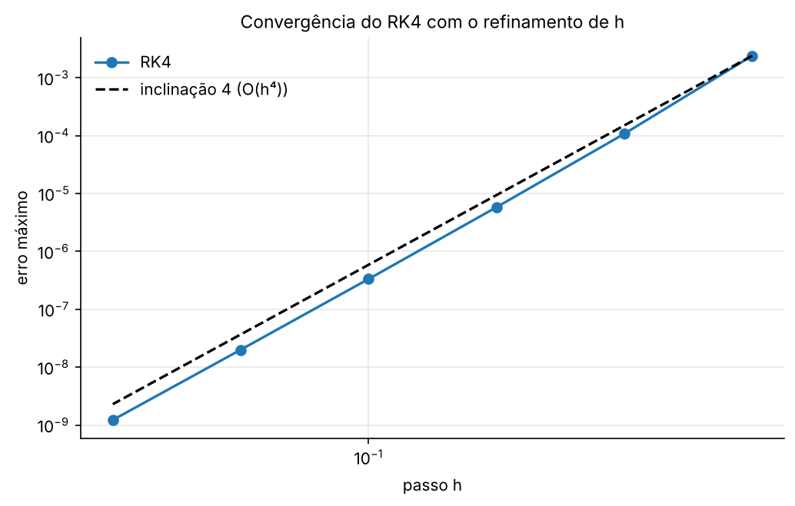
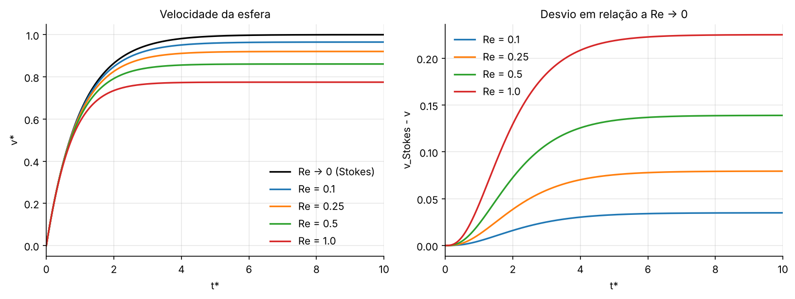

# PPC 01 — Runge-Kutta de 4ª ordem: sedimentação de uma esfera em baixo Reynolds

## Resumo operacional

Uma esfera de raio $a$ e massa específica $\rho_s$ sedimenta num fluido viscoso. Na forma adimensional (deduzida na [APC 1](../APC_01/README.md)), a velocidade obedece a:

$$St\,\frac{dv^*}{dt^*} = 1 - v^* - \frac{3}{8}Re\,{v^*}^2, \qquad v^*(0) = 0$$

O termo $1$ é o empuxo líquido. O termo $-v^*$ é o arrasto de Stokes. O termo $-\frac{3}{8}Re\,{v^*}^2$ é a correção de Oseen (efeito inercial, válida para $Re \lesssim 1$). O programa resolve esse problema de valor inicial com **RK4** e o valida contra as duas soluções exatas conhecidas.

| Regime | Solução exata |
|---|---|
| $Re \to 0$ (Stokes) | $v^* = 1 - e^{-t^*/St}$ (fator integrante) |
| $Re \ne 0$ (Oseen) | $v^* = v_\infty + \left[\dfrac{Q}{P} + \left(-\dfrac{1}{v_\infty} - \dfrac{Q}{P}\right)e^{-Pt^*}\right]^{-1}$ (Riccati) |

Na solução de Riccati:

$$v_\infty = \frac{-1 + \sqrt{1 + \tfrac32 Re}}{\tfrac34 Re}, \qquad Q = \frac{3Re}{8St}, \qquad P = -\frac34\frac{Re}{St}v_\infty - \frac{1}{St}$$

## Algoritmo (RK4 clássico)

$$k_1 = f(t_i, v_i),\quad k_2 = f\!\left(t_i + \tfrac h2,\ v_i + \tfrac h2 k_1\right),\quad k_3 = f\!\left(t_i + \tfrac h2,\ v_i + \tfrac h2 k_2\right),\quad k_4 = f(t_i + h,\ v_i + h k_3)$$

$$v_{i+1} = v_i + \frac h6\,(k_1 + 2k_2 + 2k_3 + k_4), \qquad f(t, v) = \frac{1 - v - \tfrac38 Re\,v^2}{St}$$

O integrador é a função `rk4`, de [`utils/edo.py`](../utils/edo.py). Ela serve tanto para uma EDO quanto para sistemas.

## Dicionário de variáveis

| Variável (script / JSON) | Significado | Unidade | Tipo |
|---|---|---|---|
| `v0` | velocidade inicial adimensional | – | float |
| `t_final` | instante final $t^*$ | – | float |
| `h` | passo de tempo adimensional | – | float |
| `St_lista` | números de Stokes da tarefa 1 | – | list |
| `St_estudo_passo`, `h_lista` | $St$ e passos do estudo de refinamento | – | float, list |
| `St_inercial`, `Re_lista` | $St$ e Reynolds das tarefas 3–5 | – | float, list |
| `t`, `v` | instantes e velocidades calculadas | – | array |
| `velocidade_terminal(Re)` | $v_\infty$, velocidade terminal | – | float |

## Dependências, I/O e execução

- **Dependências:** `numpy` e `matplotlib`. Nenhuma biblioteca de integração.
- **Entrada:** `inputs/parametros.json`.
- **Saídas** em `outputs/`:
  - `resultados.txt`
  - `tarefa1_stokes_varios_St.png`
  - `tarefa2_convergencia_h.png`
  - `tarefa5_efeito_Re.png`

```bash
python PPC_01_RungeKutta_Sedimentacao/main.py
```

## Resultados e validação

**Tarefa 1** ($Re \to 0$, $h = 0{,}01$): o RMSE fica entre $2{,}6\times10^{-8}$ ($St = 0{,}1$) e $2{,}7\times10^{-14}$ ($St = 5$). O erro cresce quando $St$ diminui, porque a relaxação fica mais rápida ($h/St$ maior).

**Tarefa 2** (refinamento de $h$, $St = 1$):

| $h$ | 0,8 | 0,4 | 0,2 | 0,1 | 0,05 | 0,025 |
|---|---|---|---|---|---|---|
| erro máx. | 2,4e-3 | 1,1e-4 | 5,8e-6 | 3,3e-7 | 2,0e-8 | 1,2e-9 |
| ordem | – | 4,48 | 4,22 | 4,12 | 4,06 | **4,03** |

A ordem observada tende a **4**, como a teoria prevê: dividir $h$ por 2 divide o erro por $2^4 = 16$.

**Tarefas 3 e 4** ($Re \ne 0$, $St = 1$): o erro máximo contra a solução de Riccati é menor que $10^{-10}$ para todos os $Re$, e a velocidade final coincide com $v_\infty$ exata.

**Tarefa 5:** o arrasto de Oseen **reduz a velocidade terminal**. A redução é de 3,5 % ($Re = 0{,}1$), 7,9 % ($0{,}25$), 13,9 % ($0{,}5$) e 22,5 % ($Re = 1$). O transiente também fica mais curto, porque a força resistiva extra faz a esfera atingir o regime permanente mais cedo. Para $Re \ll 1$ a correção é desprezível e se recupera o limite de Stokes.




## Bibliografia específica

- SOBRAL, Y. D.; OLIVEIRA, T. F.; CUNHA, F. R. On the unsteady forces during the motion of a sedimenting particle. *Powder Technology*, v. 178, p. 129–141, 2007.
- CHAPRA, S. C.; CANALE, R. P. *Métodos numéricos para engenharia*. 7. ed. AMGH, 2016. Cap. 25 (Runge-Kutta).
- GONTIJO, R. G. *Notas de aula do curso de Cálculo Numérico Aplicado*. UnB, 2026.
