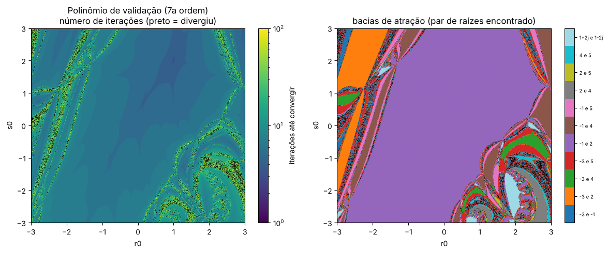
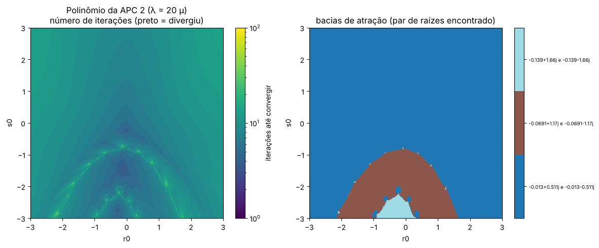

# PPC 02 — Método de Bairstow para raízes de polinômios

## Resumo operacional

O método de Bairstow encontra **todas** as raízes (reais e complexas) de um polinômio de grau $n$ usando só aritmética real. Ele divide o polinômio por um fator quadrático $x^2 - rx - s$ e usa Newton-Raphson em $(r, s)$ para zerar o resto da divisão. Quando o resto zera, a fórmula quadrática dá um par de raízes, e o processo se repete no quociente (deflação).

O programa:

1. implementa o método para grau qualquer;
2. valida com um polinômio de 7ª ordem de raízes conhecidas;
3. analisa o efeito de $(r_0, s_0)$;
4. resolve o polinômio característico $\det(\lambda^2M + \lambda C + K) = 0$ do sistema de 3 GDL da [APC 2](../APC_02/README.md);
5. interpreta os autovalores;
6. e 7. varre o plano $(r_0, s_0)$ e desenha o **fractal de Bairstow**.

## Algoritmo

Os coeficientes ficam em ordem crescente: $f(x) = a_0 + a_1x + \dots + a_nx^n$.

**Divisão sintética por $x^2 - rx - s$:**

$$b_n = a_n,\quad b_{n-1} = a_{n-1} + rb_n,\quad b_i = a_i + rb_{i+1} + sb_{i+2}\ \ (i = n-2..0)$$

**Derivadas parciais**, obtidas com uma segunda divisão sintética:

$$c_n = b_n,\quad c_{n-1} = b_{n-1} + rc_n,\quad c_i = b_i + rc_{i+1} + sc_{i+2}\ \ (i = n-2..1)$$

**Correção de Newton**, resolvida por Cramer:

$$\begin{cases} c_2\,\Delta r + c_3\,\Delta s = -b_1 \\ c_1\,\Delta r + c_2\,\Delta s = -b_0\end{cases}$$

**Raízes do fator convergido:**

$$x = \frac{r \pm \sqrt{r^2 + 4s}}{2}$$

Depois, deflaciona-se para o quociente $[b_2..b_n]$. Se sobrar grau 2, usa-se a fórmula quadrática; se sobrar grau 1, $x = -a_0/a_1$. A parada é $\max(\lvert\Delta r\rvert, \lvert\Delta s\rvert) < 10^{-10}$.

As funções `bairstow`, `divisao_quadratica` e `mapa_convergencia_bairstow` estão em [`utils/polinomios.py`](../utils/polinomios.py). O mapa aplica a mesma correção a todos os pontos da grade de uma vez, usando arrays.

## Dicionário de variáveis

| Variável (script / JSON) | Significado | Unidade | Tipo |
|---|---|---|---|
| `validacao.raizes` | raízes conhecidas do teste, em [real, imag] | – | list |
| `r0`, `s0` | chute inicial do fator quadrático | – | float |
| `tol`, `max_iter` | critério de parada e limite de iterações | – | float, int |
| `chutes_convergencia` | pares $(r_0, s_0)$ do estudo de convergência | – | list |
| `sistema_apc2` | massas, rigidezes e amortecimentos | kg, N/m, N s/m | dict |
| `polinomio_apc2_crescente` | coeficientes deduzidos à mão na APC 2 | – | list |
| `omega_ref_rad_s` | escala usada para adimensionalizar $\lambda = \omega_{ref}\,\mu$ | rad/s | float |
| `fractal` | janela, resolução, tolerância e máx. de iterações da varredura | – | dict |
| `coef` | coeficientes $[a_0..a_n]$ | – | list |
| `autovalores` | raízes $\lambda$ do polinômio característico | 1/s | list[complex] |

## Dependências, I/O e execução

- **Dependências:** `numpy` (vetores e grade do fractal) e `matplotlib`.
- **Entrada:** `inputs/parametros.json`.
- **Saídas** em `outputs/`:
  - `resultados.txt`
  - `fractal_validacao.png`
  - `fractal_apc2.png`

```bash
python PPC_02_Bairstow/main.py
```

## Resultados e validação

### Validação (7ª ordem)

As raízes conhecidas $\{-3, -1, 2, 4, 5, 1 \pm 2i\}$ geram:

$$f(x) = x^7 - 9x^6 + 16x^5 + 50x^4 - 219x^3 + 367x^2 + 10x - 600$$

O Bairstow recupera as 7 raízes com erro máximo de $4\times10^{-16}$, em 6 + 12 + 8 iterações.

### Efeito de $(r_0, s_0)$

| $(r_0, s_0)$ | iter. 1º fator | iter. totais | 1º par |
|---|---|---|---|
| (−1, −1) | 6 | 26 | 2 e −1 |
| (0, 0) | 5 | 25 | 2 e −1 |
| (2, −3) | 18 | 33 | −1 e −3 |
| (−3, 3) | 18 | 39 | 5 e 4 |
| (3, −3) | 15 | 28 | 5 e −1 |

Todos os chutes testados convergiram, mas o número de iterações muda até 3 vezes, e **qual par sai primeiro** depende do chute. Chutes perto de um fator verdadeiro, como $r = 1$, $s = 2$ (par 2 e −1), convergem rápido.

### Autovalores do sistema de 3 GDL (APC 2)

O polinômio montado pelo programa (determinante por expansão de Laplace) é **idêntico** ao deduzido à mão.

| Modo | $\sigma$ [1/s] | $\omega_d$ [rad/s] | $f_d$ [Hz] | $\omega_n$ [rad/s] | $\zeta$ | $\tau = 1/\lvert\sigma\rvert$ [s] |
|---|---|---|---|---|---|---|
| 1 | −0,261 | 10,213 | 1,63 | 10,217 | 2,55 % | 3,83 |
| 2 | −1,381 | 23,465 | 3,73 | 23,505 | 5,88 % | 0,72 |
| 3 | −2,774 | 33,198 | 5,28 | 33,313 | 8,33 % | 0,36 |

Interpretação:

- **Estável:** as três partes reais são negativas, então toda vibração livre decai.
- **Subamortecido:** são pares complexos com $\zeta \ll 1$, então o sistema oscila enquanto decai.
- **Modo dominante:** o 1º modo é o mais lento ($\tau = 3{,}8$ s) e o menos amortecido. É ele que domina a resposta a longo prazo.
- **Modos mais altos:** são mais amortecidos, porque com amortecimento proporcional $\zeta \propto \omega_n$.

A validação analítica tem três partes:

- Como $C = 0{,}005\,K$, as $\omega_n$ coincidem com as do sistema sem amortecimento, $\det(K - \omega^2M) = 0$, que também é resolvido por Bairstow.
- $\zeta_i = 0{,}005\,\omega_{n,i}/2$ confere: $0{,}005 \times 10{,}217/2 = 2{,}55\,\%$.
- O resíduo relativo é $\lvert P(\lambda)\rvert/\lvert a_6\lambda^6\rvert < 10^{-14}$, e a soma das raízes é igual a $-a_5/a_6$ (Vieta).

### Fractais de Bairstow



Para o polinômio de 7ª ordem, na janela $(r_0, s_0) \in [-3, 3]^2$ com grade de 500×500:

- 97 % dos chutes convergem, com mediana de 6 iterações.
- O mapa da esquerda mostra regiões lisas (convergência rápida e previsível) separadas por **fronteiras fractais**. Nelas, chutes vizinhos levam a pares diferentes, demoram muito ou divergem (preto).
- O mapa da direita mostra as **bacias de atração**. O par (2, −1) domina 59 % da janela, e as bordas entre bacias têm estrutura autossemelhante, típica de iterações de Newton (dinâmica não linear).

Para o polinômio da APC 2, as raízes têm módulo de 10 a 35 rad/s. Por isso ele foi **reescalado** com $\lambda = 20\,\mu$: o novo polinômio em $\mu$ é mônico, tem raízes de ordem 1 e cabe na mesma janela. Isso também melhora o condicionamento numérico, porque os coeficientes originais vão de 3 a $1{,}9\times10^8$. O mapa é muito mais regular: 100 % de convergência, com o modo mais baixo atraindo 85 % dos chutes.



## Bibliografia específica

- BAIRSTOW, L. *Applied aerodynamics*. Longmans, Green and Co., 1920 (apêndice).
- CHAPRA, S. C.; CANALE, R. P. *Métodos numéricos para engenharia*. 7. ed. AMGH, 2016. Seção 7.5 (método de Bairstow).
- RAO, S. S. *Vibrações mecânicas*. 4. ed. Pearson, 2008. Cap. 6 (sistemas com vários graus de liberdade).
