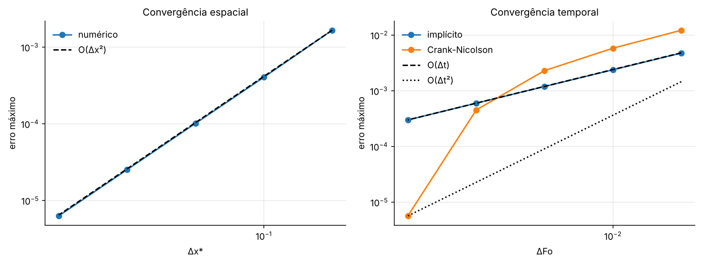
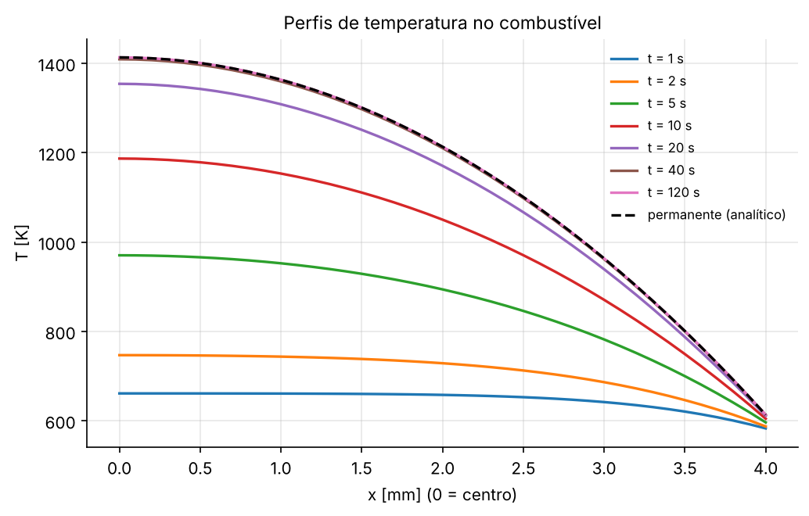
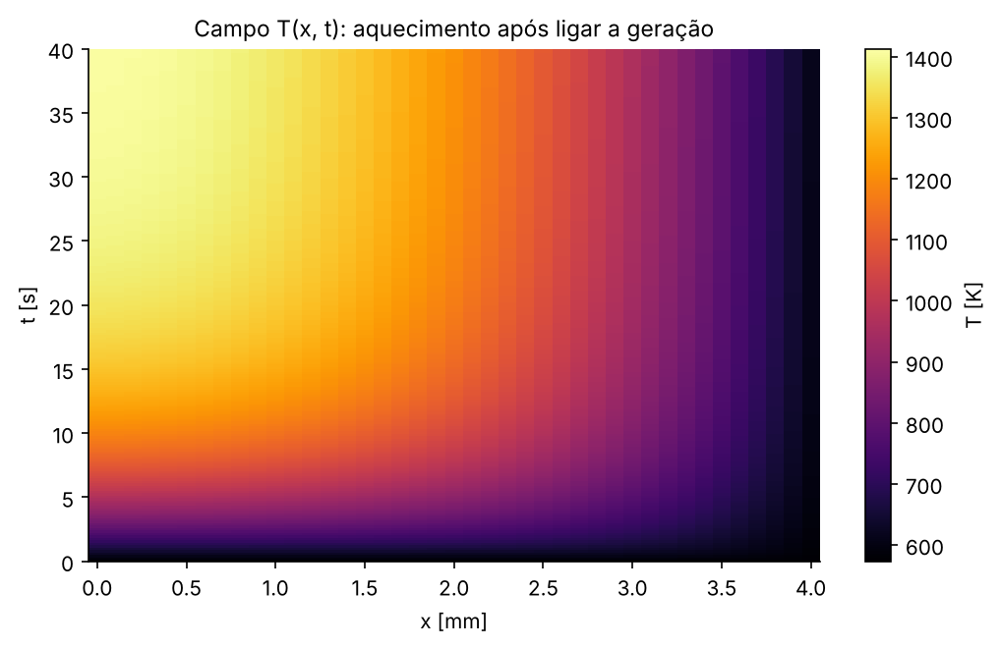

# PPC 03 — Condução transiente 1D com geração interna (combustível nuclear)

## Resumo operacional

Uma placa de combustível de meia-espessura $L$ gera calor ($\dot q$) e é resfriada por um fluido a $T_\infty$ com coeficiente $h$. Por simetria, só metade é modelada: $x = 0$ é o centro (fluxo nulo) e $x = L$ é a superfície (convecção).

$$\frac{\partial T}{\partial t} = \alpha\frac{\partial^2 T}{\partial x^2} + \frac{\dot q}{\rho c_p}, \qquad \left.\frac{\partial T}{\partial x}\right|_{0} = 0, \qquad -k\left.\frac{\partial T}{\partial x}\right|_{L} = h\,(T - T_\infty)$$

Com geração não há solução por separação de variáveis. O programa usa **diferenças finitas** com esquema **implícito** e resolve o sistema tridiagonal de cada passo com o **algoritmo de Thomas**.

## Formulação numérica

Discretizando em $N$ nós ($\Delta x = L/(N-1)$), o esquema $\beta$ da apostila é:

$$T_m^{p+1} - T_m^p = Fo\left[\beta\,(T_{m+1}^p + T_{m-1}^p - 2T_m^p) + (1 - \beta)(T_{m+1}^{p+1} + T_{m-1}^{p+1} - 2T_m^{p+1})\right] + A$$

com $Fo = \alpha\Delta t/\Delta x^2$ e $A = \dot q\Delta t/(\rho c_p)$. O valor de $\beta$ define o esquema:

- $\beta = 0$: implícito (usado aqui);
- $\beta = 1/2$: Crank-Nicolson;
- $\beta = 1$: explícito.

**Nós de contorno**, por balanço de energia em meia célula:

| Nó | Equação implícita ($\beta = 0$) |
|---|---|
| centro (simetria) | $(1 + 2Fo)\,T_1 - 2Fo\,T_2 = T_1^p + A$ |
| interno | $-Fo\,T_{m-1} + (1 + 2Fo)\,T_m - Fo\,T_{m+1} = T_m^p + A$ |
| superfície (convecção) | $-2Fo\,T_{N-1} + (1 + 2Fo + 2Fo\,Bi_{\Delta x})\,T_N = T_N^p + 2Fo\,Bi_{\Delta x}T_\infty + A$ |

> **Atenção:** nas equações dos nós, o Biot é o **da malha**, $Bi_{\Delta x} = h\Delta x/k$. Na solução exata, o Biot é o **da placa**, $Bi = hL/k$. A relação é $Bi_{\Delta x} = Bi\,\Delta x/L$. Confundir os dois é o erro mais comum neste problema.

O programa imprime a matriz $[A]$ para 7 nós, idêntica à da apostila. Os coeficientes não mudam no tempo, então a cada passo só se recalcula o lado direito e se chama o Thomas.

As funções vêm de [`utils/edp.py`](../utils/edp.py) (`conducao_transiente_1d` e `matriz_tridiagonal_1d`) e de [`utils/sistemas_lineares.py`](../utils/sistemas_lineares.py) (`thomas`). A solução exata está em [`solucao_exata.py`](solucao_exata.py).

### Solução exata (validação, sem geração)

$$\theta = \frac{T - T_\infty}{T_i - T_\infty} = \sum_{n=1}^\infty \frac{4\sin\lambda_n}{2\lambda_n + \sin 2\lambda_n}\cos(\lambda_n x^*)\,e^{-\lambda_n^2 Fo}, \qquad \lambda_n\tan\lambda_n = Bi$$

Os autovalores $\lambda_n$ são calculados por **bisseção**, usando a forma sem assíntotas $g(\lambda) = \lambda\sin\lambda - Bi\cos\lambda$. A $n$-ésima raiz fica em $[(n-1)\pi,\ (n-1)\pi + \pi/2]$, onde $g$ sempre troca de sinal. Esse é um bom exemplo de raízes de funções aparecendo dentro de um problema de EDP.

## Dicionário de variáveis

| Variável (script / JSON) | Significado | Unidade | Tipo |
|---|---|---|---|
| `Bi` | número de Biot $hL/k$ da validação | – | float |
| `n_termos_serie` | termos da série exata | – | int |
| `n_nos_escolhido`, `dFo_escolhido` | malha e passo adotados após o estudo | –, – | int, float |
| `meia_espessura_m` | $L$ | m | float |
| `k_W_mK`, `rho_kg_m3`, `cp_J_kgK` | propriedades do UO₂ | W/(m K), kg/m³, J/(kg K) | float |
| `h_W_m2K`, `T_fluido_K` | convecção e temperatura do refrigerante | W/(m² K), K | float |
| `q_geracao_W_m3` | geração volumétrica $\dot q$ | W/m³ | float |
| `x`, `t`, `T` | posições, instantes e campo $T[t, x]$ | m, s, K | array |
| `lambdas` | autovalores $\lambda_n$ | – | array |

## Dependências, I/O e execução

- **Dependências:** `numpy` e `matplotlib`. O `Pillow`, que já vem com o matplotlib, é usado no GIF.
- **Entrada:** `inputs/parametros.json`.
- **Saídas** em `outputs/`:
  - `resultados.txt`
  - `tarefa1_validacao_perfis.png`
  - `tarefa1_convergencia.png`
  - `tarefa3_perfis.png`
  - `tarefa3_mapa_x_t.png`
  - `tarefa3_historico.png`
  - `tarefa3_animacao.gif`

```bash
python PPC_03_Conducao_Transiente/main.py      # ~10 s
```

## Resultados

### Tarefa 1: validação sem geração ($Bi = 1$, 41 nós, $\Delta Fo = 5\times10^{-4}$)

| $Fo$ | $\theta(0)$ numérico | $\theta(0)$ exato | erro máx. |
|---|---|---|---|
| 0,05 | 0,999710 | 0,999751 | 3,9×10⁻⁴ |
| 0,2 | 0,950568 | 0,950642 | 1,4×10⁻⁴ |
| 1,0 | 0,533938 | 0,533859 | 7,9×10⁻⁵ |

Estudo de convergência em $Fo = 0{,}2$:

- **Malha:** o erro cai 4 vezes a cada vez que $\Delta x$ cai à metade (de 1,7×10⁻³ a 6,3×10⁻⁶), confirmando a ordem **$O(\Delta x^2)$** das diferenças centrais.
- **Tempo:**
  - O implícito tem erro $O(\Delta t)$: cai de 4,7×10⁻³ para 3,0×10⁻⁴, exatamente à metade a cada refinamento.
  - O Crank-Nicolson é $O(\Delta t^2)$ só para passos pequenos. Com passos grandes ($Fo_{\Delta t} \gg 1$) e a condição inicial descontínua na superfície, ele **oscila** e erra mais que o implícito. Ele é estável, mas não amortece os modos de alta frequência.
- **Estabilidade:**
  - O explícito com $Fo_{\Delta t} = 0{,}4$ é estável.
  - Com $Fo_{\Delta t} = 0{,}6$ ele **explode** ($\max\lvert\theta\rvert \approx 5\times10^{16}$), porque viola $Fo \le 1/2$.
  - O implícito é estável até com $Fo_{\Delta t} = 5$.



### Tarefa 2: geração interna

- **Limite $\dot q \to 0$:** com $\dot q = 10^{-3}$ W/m³, a diferença para o caso sem geração é de $2{,}5\times10^{-9}$ K.
- **Regime permanente analítico:** $T(x) = T_\infty + \dfrac{\dot qL}{h} + \dfrac{\dot q(L^2 - x^2)}{2k}$, com $T(0) = 1413{,}15$ K e $T(L) = 613{,}15$ K. O numérico em $t = 120$ s difere em $9\times10^{-5}$ K.

| $t$ [s] | 1 | 2 | 5 | 10 | 20 | 40 | 120 |
|---|---|---|---|---|---|---|---|
| $T$ centro [K] | 661 | 747 | 970 | 1187 | 1354 | 1409 | 1413 |
| $T$ superfície [K] | 583 | 587 | 596 | 604 | 611 | 613 | 613 |

O Biot do combustível é alto ($Bi = 40$): quase toda a diferença de temperatura (800 de 840 K) está **dentro** do combustível, por condução. Só 40 K ficam na película de convecção. Por isso a temperatura de centro, perto de 1140 °C, é o parâmetro limitante de projeto.




### Tarefa 4: valores realistas (placa de UO₂ num PWR)

| Grandeza | Valor | Observação |
|---|---|---|
| $L$ (meia-espessura) | 4 mm | ordem do raio de uma pastilha de PWR (~4,1 mm) |
| $k$ (UO₂) | 3 W/(m K) | o UO₂ é mau condutor; $k$ cai com $T$, ficando entre ~2,5 e 4 W/(m K) nas temperaturas de operação |
| $\rho$, $c_p$ | 10 970 kg/m³; 300 J/(kg K) | $\alpha = 9{,}1\times10^{-7}$ m²/s |
| $\dot q$ | 3×10⁸ W/m³ | taxa linear de ~20 kW/m numa pastilha |
| $h$ | 30 000 W/(m² K) | água pressurizada em convecção forçada |
| $T_\infty$ | 573 K (300 °C) | refrigerante do circuito primário |

## Bibliografia específica

- INCROPERA, F. P. et al. *Fundamentos de transferência de calor e de massa*. 7. ed. LTC, 2014. Cap. 5 (condução transiente) e seção 5.10 (diferenças finitas).
- TODREAS, N. E.; KAZIMI, M. S. *Nuclear systems I: thermal hydraulic fundamentals*. 2. ed. CRC Press, 2011. Cap. 8 (condução em elementos combustíveis).
- CHAPRA, S. C.; CANALE, R. P. *Métodos numéricos para engenharia*. 7. ed. AMGH, 2016. Seção 11.1 (algoritmo de Thomas) e cap. 30 (EDPs parabólicas).
- GONTIJO, R. G. *Introdução à condução de calor em regime transiente* e *Condução transiente - Parte 2*. Canal Ciência e Brisa (YouTube).
